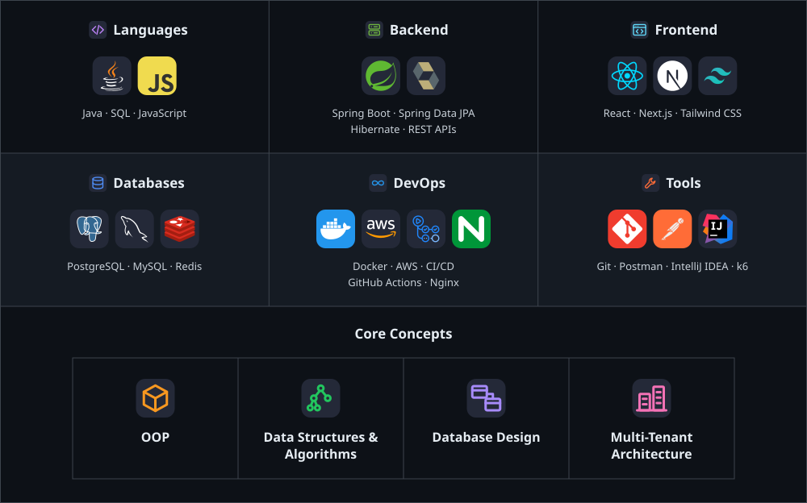

<!-- ============================ HERO ============================= -->

**Building scalable backend systems with Java, Spring Boot and MySQL — RESTful APIs, multi-tenant architectures and secure role-based access control.**

 

<!-- ========================== WHO AM I =========================== -->

**Software Development Engineer** with **1+ year of experience** building scalable backend systems using **Java, Spring Boot, and MySQL**. Skilled in designing **RESTful APIs**, **multi-tenant architectures**, and secure **role-based access control**, with a focus on query optimization and caching. **Hackathon winner.**

<!-- ======================== TECH STACK =========================== -->

 

<!-- ================== PROFESSIONAL EXPERIENCE ==================== -->

 

### Software Development Engineer
**Triostack Technologies Pvt. Ltd.** &nbsp;|&nbsp; Greater Noida, U.P. &nbsp;|&nbsp; *Aug 2025 – Present*

- Developed scalable full-stack web applications, building responsive user interfaces, RESTful APIs, and server-side business logic with secure authentication, role-based access control, payment gateway integration, and multi-tenant data isolation across relational and MySQL databases.
- Improved application performance and scalability through database query optimization, indexing, caching, and load testing.

### Software Development Intern
**Triostack Technologies Pvt. Ltd.** &nbsp;|&nbsp; *Jun 2025 – Aug 2025*

- Worked on full-stack web application development.
- Developed features using PHP, JavaScript, React and Node.js.
- Worked with databases and REST-based application workflows.
- Assisted in developing and improving production applications.

<!-- ====================== FEATURED PROJECTS ====================== -->

###  &nbsp;EdTech Platform

<table>
<tr>
<td width="70%" valign="top">

Multi-tenant EdTech platform where coaching institutes and educators run their own online academy.

- **Multi-tenancy:** Every institute’s data stays isolated, with separate portals for institutes, teachers, students and platform admins.
- **Live classes:** Real-time online classes with chat and interaction, plus saved recordings students can watch later.
- **Marketplace & payments:** Built-in marketplace for courses and study material, with integrated online payments, coupons and a student wallet.

</td>
<td width="30%" valign="top">

<b>Tech Stack</b>  

</td>
</tr>
</table>

 

###  &nbsp;School ERP

<table>
<tr>
<td width="70%" valign="top">

Multi-tenant SaaS ERP built for a client that helps schools and colleges run their daily administration in one place.

- **Fees:** Fee plans, discounts, transport fees, payment recording, receipts and dues tracking.
- **Exams & results:** Exam setup, marks entry, grading rules, grace marks, remarks and result publishing.
- **Access & dashboards:** Role-based access (teachers see only their assigned classes) and separate dashboards for owners, accountants, teachers and students, with charts and live updates.

</td>
<td width="30%" valign="top">

<b>Tech Stack</b>  

</td>
</tr>
</table>

 

###  &nbsp;Trio CRM

<table>
<tr>
<td width="70%" valign="top">

Multi-tenant Customer Relationship Management (CRM) platform.

- **Core modules:** Customer management, business workflows, data management, user operations and application dashboards.
- **Integrations & performance:** Built REST APIs with WhatsApp and cloud storage integrations, and implemented Redis caching to improve application performance.
- **DevOps & monitoring:** Automated deployments with Docker, Kubernetes, and Jenkins; monitored production systems using Grafana.

</td>
<td width="30%" valign="top">

<b>Tech Stack</b>  

</td>
</tr>
</table>

 

###  &nbsp;Payroll System

<table>
<tr>
<td width="70%" valign="top">

Multi-tenant payroll and HR platform for educational institutions.

- **Multi-tenancy:** Each school is a separate tenant, with strict data isolation between tenants; school owners switch between their schools from one login, and super admins onboard schools, invite owners and HR staff by email and report across all schools.
- **Payroll workflow:** Step-by-step runs: attendance lock, salary calculation, review, approval through a configurable chain, lock and mark as paid.
- **Indian compliance:** PF, ESI, state-wise Professional Tax, Labour Welfare Fund and TDS, with tax declarations, Form 16 from an editable template, challans, compliance reports, gratuity, final settlement and long-service awards.

</td>
<td width="30%" valign="top">

<b>Tech Stack</b>  

</td>
</tr>
</table>

 

###  &nbsp;Question Paper Generator

<table>
<tr>
<td width="70%" valign="top">

Multi-tenant platform that coaching institutes and schools use to build, manage and print exam papers.

- **Multi-tenancy:** Each organisation’s data, users and question bank kept separate, with a shared global catalogue of boards, classes, subjects, chapters and topics available to every tenant.
- **AI Smart Generate:** Creates questions from a selected syllabus using OpenAI, Gemini or Anthropic with a switchable provider, saving generated questions back into the question bank so the library keeps growing.
- **Output & sharing:** Configurable header, logo, instructions and layout, PDF export with an answer key, and papers shared from admins to teachers with access granted or revoked.

</td>
<td width="30%" valign="top">

<b>Tech Stack</b>  

</td>
</tr>
</table>

 

###  &nbsp;E-Commerce Platform

<table>
<tr>
<td width="70%" valign="top">

Full-stack e-commerce platform built for a client D2C brand with customisable products.

- **Payments:** Razorpay checkout with tax-inclusive pricing, coupons, domestic and international orders, subscription plans and shareable payment links for custom orders.
- **Shipping & orders:** Shiprocket integration with delivery availability checks, live order tracking and self-service cancellation, return, replacement and refund requests.
- **Admin panel:** Sales, revenue and order analytics, role-based access for team members, coupon management and admin activity logs.

</td>
<td width="30%" valign="top">

<b>Tech Stack</b>  

</td>
</tr>
</table>

 

###  &nbsp;Bake-Ree

<table>
<tr>
<td width="70%" valign="top">

Full-stack bakery management and operations platform that brings the customer storefront and the bakery’s back office into one system.

- **Order lifecycle:** Server-enforced state machine from approval through preparing, hold, ready, dispatch and delivery, with real-time notifications for customers, kitchen and admins over Socket.io rooms.
- **Delivery:** Live order tracking and distance-based delivery charges with Google Maps APIs, plus delivery zones, routes and driver assignment.
- **Inventory & procurement:** Warehouses, bins, stock batches and a stock ledger with FEFO allocation, transfers, waste logging and expiry alerts; vendors, purchase orders, goods receipts, vendor bills, payments and returns.

</td>
<td width="30%" valign="top">

<b>Tech Stack</b>  

</td>
</tr>
</table>

<!-- ========================== EDUCATION ========================== -->

### Dr. A.P.J. Abdul Kalam Technical University 
B.Tech – Computer Science & Engineering

<!-- ======================== GITHUB STATS ========================= -->

### 📈 Contribution Graph

### 🐍 Contribution Snake

<picture>
  <source media="(prefers-color-scheme: dark)" srcset="https://raw.githubusercontent.com/priyanshupatel288/priyanshupatel288/output/github-contribution-grid-snake-dark.svg" />
  <source media="(prefers-color-scheme: light)" srcset="https://raw.githubusercontent.com/priyanshupatel288/priyanshupatel288/output/github-contribution-grid-snake.svg" />
  
</picture>

